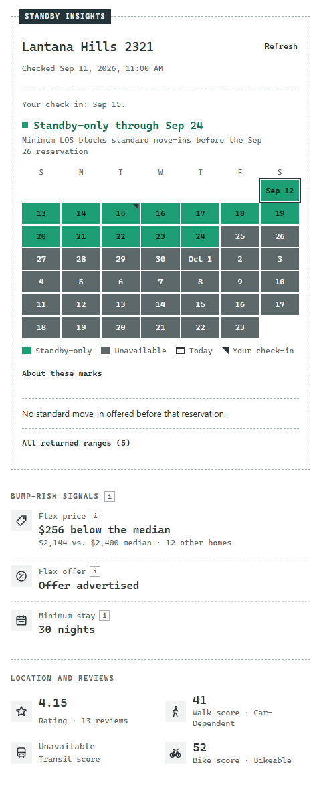
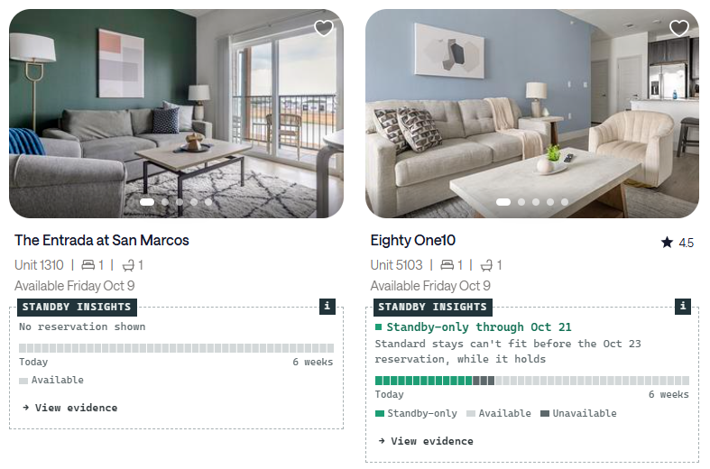

# Standby Insights

A free Chrome extension for Landing Standby members. It shows, right on the search results, which homes have **standby-only nights**: nights too short for a standard stay because a reservation follows, so only Standby can book them.

It's a personal project by a Standby member. It isn't made, endorsed or supported by Landing.

## What it shows

**On each Standby search card**, as it scrolls into view:

- Whether the home has a standby-only gap from your date, and the reservation that creates it ("Standby-only through Oct 24. Standard stays can't fit before the Oct 26 reservation.")
- A six-week strip starting today, with your check-in date marked
- A **View evidence** button that opens the side panel

**In the side panel**, for the home you picked:

- The same six weeks as a calendar: green for standby-only, gray for unavailable, an outlined day where a standard move-in is offered, and hatching where Landing's calendar returned nothing
- Every range the calendar returned, in order
- **Bump-risk signals**, facts to weigh for yourself:
  - **Flex price:** the home's advertised monthly price against the median of other homes with the same bedroom count in the same market
  - **Flex offer:** whether any Flex term advertises a special offer
  - **Minimum stay:** a shorter one lets short-term guests book too
- Rating with review count, and walk, transit and bike scores
- When it last checked, and a **Refresh** button

## What it won't do

- **It never says a stay is safe or protected.** A standby-only gap can open to standard bookings if the reservation after it moves or is cancelled. The extension states what the calendar says and when it checked.
- **It never guesses.** If the calendar has gaps or didn't load, it says so instead of filling them in. If there are fewer than five comparable homes, it shows no median.
- **It doesn't predict prices or quote your stay.** The Flex price is Landing's current advertised monthly price, not a quote for your dates.

## Privacy

- It uses only Landing's [public API](https://www.hellolanding.com/llms.txt), the one Landing publishes for outside tools. It calls two read-only endpoints: a home's public details and the public apartment search.
- It never sends your login or cookies. It works the same signed in or signed out.
- It saves nothing. Close the tab and everything it read is gone. It doesn't even request permission to store data.
- It doesn't run in the background, and it limits itself to a few requests per second.

The code is all here, so you can check any of this yourself.

## Install

Chrome doesn't list it in the Web Store yet, so you load it yourself. It takes about two minutes.

1. Download `standby-insights-vX.Y.Z.zip` from the [latest release](https://github.com/ezadzzz/standby-insights/releases/latest). Unzip it.
2. In Chrome, go to `chrome://extensions` and turn on **Developer mode** (top right).
3. Click **Load unpacked** and choose the unzipped `standby-insights` folder (the one containing `manifest.json`).
4. Open a Landing Standby search, such as `https://www.hellolanding.com/s/austin-tx/apartments/standby`. Cards are annotated as they scroll into view.
5. Click a card's **View evidence**, or the extension's toolbar icon, to open the side panel.

Chrome shows a reminder about Developer-mode extensions. That's expected for anything loaded this way.

**To update:** download the latest release's ZIP, replace the old folder, click the reload arrow on the extension's card in `chrome://extensions`, then reload any open Landing tabs.

## Limits

- Desktop Chrome only.
- Works on Landing's Standby search pages and Standby home pages, in English.
- Tested in Austin and Dallas. Other markets should work but haven't been checked. If something looks wrong, please [open an issue](https://github.com/ezadzzz/standby-insights/issues).

## For developers

How it's built and tested, including the live browser checks and the known gaps: [docs/DEVELOPMENT.md](docs/DEVELOPMENT.md).

## License

[MIT](LICENSE)
